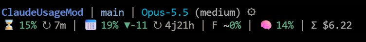

# usage-bar — Claude usage above your prompt

A mod for **Claude Code** and **Claude Desktop** that draws a band above the prompt with your Claude quotas, their resets, the context window, what the session cost, the git state of the project and the agents that are running.



It replaces [ClaudeUsageStatusLine](https://www.digital3d.com/Blog/88): no binary to download, no status line command to configure, nothing to build. The mod is a single TypeScript module that the Claude engine loads by itself.

## What the band shows

| Segment | Meaning |
| --- | --- |
| project, branch, `↑` `↓` | The folder of the session, the checked-out branch, the commits ahead of and behind its upstream |
| model `(effort)` `⚙` | The model of the session and its reasoning effort — click the gear to open `/model` |
| `⌛` | The 5-hour session quota, when it resets (`↻`), and when it is projected to run out at the current pace — click the icon to open `/usage` |
| `📅` | The weekly quota, when it resets, and how far you run ahead of or behind an even pace over the week |
| `F` | The Fable weekly quota |
| `🧠` | How full the context window is — click the icon to open `/context` |
| `Σ $` | What the session cost so far — click to open `/cost` |
| files, `+` `-` | The uncommitted files and lines of the working tree |
| `▶` | The subagents that are running, and for how long |

On a narrow terminal the band drops its least important details first.

Each gauge takes the *ok*, *warning* or *danger* color from two thresholds you choose, and a toast warns you once when a quota, the context window or the projection crosses a level you set.

The quota gauges need a session signed in with a Claude subscription (Pro, Max, Team or Enterprise): they come from the usage endpoint of your own account, on `api.anthropic.com`. The mod sends nothing anywhere else.

## Install

### One line, from a Claude Code terminal session

```
/plugin install usage-bar --marketplace Digital3D/claude-usage-bar
```

Answer `y` to add the marketplace, press Enter to keep the *user* scope, set the options or keep the defaults. The band appears at once, in that session and in every session started after, Claude Desktop included.

### By hand

Copy the `usage-bar` folder of this repository into the `mods` folder of your Claude configuration:

```bash
git clone https://github.com/Digital3D/claude-usage-bar
mkdir -p ~/.claude/mods
cp -r claude-usage-bar/usage-bar ~/.claude/mods/
```

On Windows (PowerShell):

```powershell
git clone https://github.com/Digital3D/claude-usage-bar
New-Item -ItemType Directory -Force "$HOME\.claude\mods" | Out-Null
Copy-Item -Recurse claude-usage-bar\usage-bar "$HOME\.claude\mods\"
```

Then start a new session.

## Commands

| Command | Effect |
| --- | --- |
| `/usage-bar` | Hide the band, or show it again |
| `/usage-bar hide` · `/usage-bar show` | Hide or show the band |
| `/usage-bar full` · `/usage-bar compact` | Draw the band on two lines, or on a single one |
| `/usage-bar refresh` | Ask the usage endpoint again now |
| `/usage-bar config` | Open the settings pane |
| `/usage-bar status` | Say the layout in use and what the usage endpoint last answered |

## Settings

Set them from `/usage-bar config`. They are hidden from the `/config` list, but `/config usage-bar.<name>=<value>` still writes one.

| Setting | Default | Meaning |
| --- | --- | --- |
| `layout` | `full` | `full` (two lines), `compact` (one line) or `hidden` (alerts only) |
| `resetStyle` | `delay` | Show a reset as the delay left (`delay`) or as a time of day (`time`) |
| `warnPercent` | `50` | Percentage from which a gauge takes the warning color |
| `dangerPercent` | `90` | Percentage from which a gauge takes the danger color |
| `quotaAlerts` | `50,80,90` | Quota percentages that raise an alert; empty for none |
| `contextAlerts` | `80` | Context percentages that raise an alert; empty for none |
| `projectionAlertMinutes` | `30` | Alert when the session quota is projected full within that many minutes; `0` for none |
| `colorOk`, `colorWarn`, `colorDanger` | `green`, `#ff8c00`, `red` | Gauge colors, a name or `#rrggbb` |
| `background` | `#0d0f14` | Background of the band |
| `showFable`, `showContext`, `showGit`, `showCost`, `showActivity`, `showProjection`, `showPace` | `true` | Show or drop a segment |

## Uninstall

`/plugin uninstall usage-bar`, or delete `~/.claude/mods/usage-bar` if you copied it by hand.

## Development

```bash
claude plugin validate usage-bar
claude plugin test usage-bar
claude --plugin-dir ./usage-bar     # a session with the mod loaded from this folder
```

## License

[MIT](LICENSE) — © Digital3D
